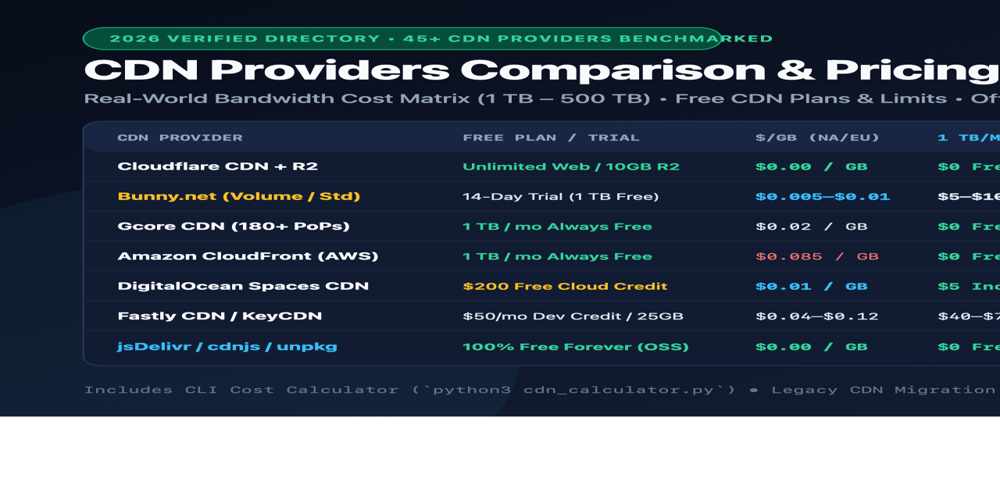

<div align="center">

# CDN Providers List, Free Plans & Bandwidth Cost Calculator (2026)

**The complete, verified comparison of 46 active CDN providers — featuring real-world cost calculations from 1 TB to 500 TB/month, free CDN plans with exact restrictions, official tariff links, and a legacy CDN migration guide.**

[](#-complete-cdn-providers-comparison-table-2026)
[](#-multi-volume-cdn-cost-calculation-1-tb--10-tb--50-tb--100-tb--500-tb)
[](#-free-cdn-plans--hidden-restrictions-compared)
[](LICENSE)

[**📊 Multi-Volume Cost Matrix**](#-multi-volume-cdn-cost-calculation-1-tb--10-tb--50-tb--100-tb--500-tb) • [**🆓 Free CDN Plans & Limits**](#-free-cdn-plans--hidden-restrictions-compared) • [**📋 All 46 CDN Providers**](#-complete-cdn-providers-comparison-table-2026) • [**🎬 Video & Image CDNs**](#-video-streaming--image-optimization-cdns) • [**📦 Open-Source JS/npm CDNs**](#-free-open-source-js-css--npm-cdns) • [**🪦 Legacy CDN Graveyard**](#-legacy-cdn-graveyard--2026-migration-guide-maxcdn-edgio-stackpath) • [**🧮 CLI Calculator**](#-interactive-cli-cost-calculator) • [**❓ FAQ**](#-frequently-asked-questions-faq)

</div>

---

## What is This CDN Providers Directory?

Most **CDN providers** lists on GitHub are outdated 2015–2018 link dumps filled with shut-down networks (*MaxCDN*, *StackPath*, *EdgeCast/Edgio*, *RawGit*, *CoralCDN*, *Incapsula Free*) and zero pricing math. Picking the wrong Content Delivery Network can cost **$750 to $54,000+ per month** in surprise egress and HTTP request fees at 100 TB scale.

This repository is an actively maintained, **verification-dated (`2026-11-15`) CDN comparison and bandwidth cost calculator** covering **46 active CDN providers** and **12 retired/acquired legacy CDNs**. Every entry includes **per-GB regional rates**, **multi-volume monthly cost calculations (1 TB, 10 TB, 50 TB, 100 TB, 500 TB)**, **free tier quotas and Terms of Service traps**, and **direct links to official pricing pages**.



---

## ⚡ Quick Decision Matrix: Which CDN Provider Should You Pick?

| Your Scenario / Workload | Top Recommended CDN | Why It Wins | Verified Tariff Link |
| :--- | :--- | :--- | :---: |
| **Websites, SaaS & APIs (Best Overall Free)** | [**Cloudflare CDN**](https://www.cloudflare.com/plans/) | Unlimited unmetered web traffic + Free SSL + WAF on Free plan | [Official Plans →](https://www.cloudflare.com/plans/) |
| **Static Assets, Downloads & Best Price/Perf** | [**Bunny.net (Standard / Volume)**](https://bunny.net/pricing/) | $0.005–$0.01/GB, **zero request fees**, 123+ PoPs, $1/mo minimum | [Official Pricing →](https://bunny.net/pricing/) |
| **Zero-Egress Object Storage + CDN** | [**Cloudflare R2**](https://developers.cloudflare.com/r2/pricing/) / [**Backblaze B2**](https://www.backblaze.com/cloud-storage/pricing) | **$0.00/GB egress forever** (allowed for video, binaries & archives) | [R2 Pricing →](https://developers.cloudflare.com/r2/pricing/) |
| **1 TB/mo Always-Free S3 or Game/App CDN** | [**Gcore CDN**](https://gcore.com/pricing/cdn) / [**AWS CloudFront**](https://aws.amazon.com/cloudfront/pricing/) | Both include **1 TB/month Always Free** + 1M–10M free requests | [Gcore →](https://gcore.com/pricing/cdn) • [AWS →](https://aws.amazon.com/cloudfront/pricing/) |
| **10 TB/mo Always-Free Outbound Egress** | [**Oracle Cloud (OCI)**](https://www.oracle.com/cloud/networking/pricing/) | First **10 TB/month outbound transfer is $0.00** in every region | [OCI Pricing →](https://www.oracle.com/cloud/networking/pricing/) |
| **OTT Video Streaming & Live HLS/DASH** | [**Bunny Stream**](https://bunny.net/stream/) / [**CDN77**](https://www.cdn77.com/pricing) | Free HLS transcoding ($0.005/GB) or 150+ Tbps dedicated video backbone | [Bunny Stream →](https://bunny.net/stream/) • [CDN77 →](https://www.cdn77.com/pricing) |
| **Dynamic APIs & <150ms Instant Purge** | [**Fastly CDN**](https://www.fastly.com/pricing/) | **$50/mo Always-Free developer tier**, Varnish VCL, Compute@Edge Wasm | [Fastly Pricing →](https://www.fastly.com/pricing/) |
| **Open-Source npm, JS & GitHub Libraries** | [**jsDelivr**](https://www.jsdelivr.com/) / [**cdnjs**](https://cdnjs.com/) | 100% free forever Multi-CDN (750+ PoPs) with SRI & ESM support | [jsDelivr →](https://www.jsdelivr.com/) |

---

## 📊 Multi-Volume CDN Cost Calculation (1 TB / 10 TB / 50 TB / 100 TB / 500 TB)

> **Calculation Methodology (Verified `2026-11-15`):** Monthly estimates assume **North America & Europe (NA/EU)** public pay-as-you-go list prices (`1 TB = 1,000 GB`), **25M HTTP/HTTPS requests/month** at 10 TB scaling proportionally, and standard self-serve volume tiers. Enterprise commitments (100 TB–500 TB+) with *CloudFront*, *Fastly*, *Akamai*, or *CDN77* can be negotiated lower via custom contracts.

| CDN Provider | Free Quota | $/GB (NA/EU) | 1 TB/mo | 10 TB/mo | 50 TB/mo | 100 TB/mo | 500 TB/mo | Official Tariff & Verified Date |
| :--- | :--- | :---: | :---: | :---: | :---: | :---: | :---: | :--- |
| [**Cloudflare CDN**](https://www.cloudflare.com/plans/) | Unlimited HTML/CSS/JS | `$0.00` | **$0** | **$0** | **$20** *(Pro)* | **$200** *(Biz)* | **$2,500+** *(Ent)* | [cloudflare.com/plans](https://www.cloudflare.com/plans/) (`2026-11-15`) |
| [**Cloudflare R2 + CDN**](https://developers.cloudflare.com/r2/pricing/) | 10 GB storage + ∞ Egress | `$0.00` egress | **$0** | **$15** *(1TB store)* | **$45** | **$90** | **$360** | [developers.cloudflare.com/r2](https://developers.cloudflare.com/r2/pricing/) (`2026-11-15`) |
| [**Hetzner Object + CF**](https://www.hetzner.com/cloud/object-storage/) | 1 TB incl. in €4.99/mo | `$0.001` | **$5.39** | **$14.39** | **$54.39** | **$104.39** | **$504.39** | [hetzner.com/cloud](https://www.hetzner.com/cloud/object-storage/) (`2026-11-15`) |
| [**Bunny.net (Volume)**](https://bunny.net/pricing/) | 14-day trial (1 TB) | `$0.005` | **$5** | **$50** | **$250** | **$450** | **$1,500** | [bunny.net/pricing](https://bunny.net/pricing/) (`2026-11-15`) |
| [**BlazingCDN**](https://blazingcdn.com/pricing/) | $5 trial credit | `$0.005` | **$5** | **$50** | **$225** | **$400** | **$1,500** | [blazingcdn.com/pricing](https://blazingcdn.com/pricing/) (`2026-11-15`) |
| [**Bunny.net (Standard)**](https://bunny.net/pricing/) | 14-day trial (1 TB) | `$0.01` | **$10** | **$100** | **$500** | **$1,000** | **$5,000** | [bunny.net/pricing](https://bunny.net/pricing/) (`2026-11-15`) |
| [**DigitalOcean Spaces**](https://www.digitalocean.com/pricing/spaces-object-storage) | $200 credit (60d) + 1 TB | `$0.01` | **$5** | **$95** | **$495** | **$995** | **$4,995** | [digitalocean.com/pricing](https://www.digitalocean.com/pricing/spaces-object-storage) (`2026-11-15`) |
| [**Oracle Cloud (OCI)**](https://www.oracle.com/cloud/networking/pricing/) | **10 TB/mo Always Free** | `$0.0085` | **$0** | **$0** | **$340** | **$765** | **$4,165** | [oracle.com/cloud](https://www.oracle.com/cloud/networking/pricing/) (`2026-11-15`) |
| [**OVHcloud CDN**](https://www.ovhcloud.com/en/cdn/) | Bundled w/ select hosts | `$0.008` | **$19** | **$91** | **$411** | **$811** | **$4,011** | [ovhcloud.com/en/cdn](https://www.ovhcloud.com/en/cdn/) (`2026-11-15`) |
| [**Gcore CDN**](https://gcore.com/pricing/cdn) | **1 TB/mo Always Free** | `$0.02` | **$0** | **$180** | **$450** | **$750** | **$2,000** | [gcore.com/pricing/cdn](https://gcore.com/pricing/cdn) (`2026-11-15`) |
| [**CDNsun**](https://cdnsun.com/pricing) | 15-day trial (50 GB) | `$0.02` | **$20** | **$200** | **$950** | **$1,800** | **$7,500** | [cdnsun.com/pricing](https://cdnsun.com/pricing) (`2026-11-15`) |
| [**CDN77**](https://www.cdn77.com/pricing) | 30-day trial (1 TB) | `$0.015` | **$199** *(min)* | **$199** *(min)* | **$650** | **$990** | **$2,250** | [cdn77.com/pricing](https://www.cdn77.com/pricing) (`2026-11-15`) |
| [**CacheFly**](https://www.cachefly.com/pricing/) | 5 TB POC trial | `$0.015` | **$295** *(min)* | **$295** *(min)* | **$650** | **$1,100** | **$2,500** | [cachefly.com/pricing](https://www.cachefly.com/pricing/) (`2026-11-15`) |
| [**KeyCDN**](https://www.keycdn.com/pricing) | 14-day trial (25 GB) | `$0.04` | **$40** | **$400** | **$1,600** | **$2,600** | **$6,600** | [keycdn.com/pricing](https://www.keycdn.com/pricing) (`2026-11-15`) |
| [**Google Cloud CDN**](https://cloud.google.com/cdn/pricing) | $300 GCP trial credit | `$0.08` | **$85** | **$810** | **$2,950** | **$5,450** | **$16,500** | [cloud.google.com/cdn](https://cloud.google.com/cdn/pricing) (`2026-11-15`) |
| [**Amazon CloudFront**](https://aws.amazon.com/cloudfront/pricing/) | **1 TB/mo Always Free** | `$0.085` | **$0** | **$775** | **$4,015** | **$7,515** | **$26,500** | [aws.amazon.com/cloudfront](https://aws.amazon.com/cloudfront/pricing/) (`2026-11-15`) |
| [**Azure Front Door**](https://azure.microsoft.com/en-us/pricing/details/frontdoor/) | $200 Azure credit | `$0.081` | **$116** | **$855** | **$3,600** | **$6,800** | **$24,000** | [azure.microsoft.com](https://azure.microsoft.com/en-us/pricing/details/frontdoor/) (`2026-11-15`) |
| [**Fastly CDN**](https://www.fastly.com/pricing/) | **$50/mo Always Free** | `$0.12` | **$75** | **$1,150** | **$4,600** | **$8,200** | **$29,000** | [fastly.com/pricing](https://www.fastly.com/pricing/) (`2026-11-15`) |
| [**Vercel Edge Network**](https://vercel.com/pricing) | 100 GB Hobby Free | `$0.15` | **$20** *(Pro)* | **$1,370** | **$7,370** | **$14,870** | **$74,870** | [vercel.com/pricing](https://vercel.com/pricing) (`2026-11-15`) |
| [**Netlify Edge CDN**](https://www.netlify.com/pricing/) | 100 GB Starter Free | `$0.55` ⚠️ | **$19** *(Pro)* | **$4,969** ⚠️ | **$26,969** | **$54,469** | **$274,469** | [netlify.com/pricing](https://www.netlify.com/pricing/) (`2026-11-15`) |

> **⚠️ Key Pricing Insight:** Notice the **15x–100x cost gap** at 100 TB/month. Serving 100 TB of downloads or video from **Vercel ($14,870/mo)** or **Netlify ($54,469/mo)** is catastrophic compared to **Cloudflare R2 ($90/mo)**, **Bunny.net Volume ($450/mo)**, or **CDN77 ($990/mo)**.

---

## 🆓 Free CDN Plans & Hidden Restrictions Compared

Every **"free CDN"** comes with strict Terms of Service boundaries, request caps, or non-commercial clauses. Always check these **14 verified free tiers** before deploying to production (`Last Verified: 2026-11-15`):

| Free CDN Provider | Free Monthly Allowance | Request / File Limits | Commercial Use? | Critical Restrictions & Traps | Official Free Tier Docs |
| :--- | :--- | :--- | :---: | :--- | :--- |
| **Cloudflare Free** | **Unlimited** bandwidth | 100 MB max upload/file (Free) | ✅ Yes | **Prohibits raw video, audio, or binary archive hosting** unless paired with R2 or Stream | [Cloudflare Plans →](https://www.cloudflare.com/plans/) |
| **Cloudflare Pages** | **Unlimited** static bandwidth | 25 MB/file • 20,000 files | ✅ Yes | Static sites & Workers SSR only; 500 builds/month | [Pages Limits →](https://pages.cloudflare.com/) |
| **Cloudflare R2** | **10 GB** storage + **∞ Egress** | 1M Class A + 10M Class B/mo | ✅ Yes | Credit card required to activate (free within quota); $0.015/GB-mo storage above 10 GB | [R2 Pricing →](https://developers.cloudflare.com/r2/pricing/) |
| **Oracle Cloud (OCI)** | **10 TB/mo** outbound egress | 4 ARM cores + 200 GB SSD | ✅ Yes | Credit card verification required; raw VM/Object egress (pair with Cloudflare for Edge PoPs) | [OCI Free Tier →](https://www.oracle.com/cloud/networking/pricing/) |
| **Amazon CloudFront** | **1 TB/mo** Always Free | **10,000,000 HTTP/S reqs/mo** | ✅ Yes | **$0.085/GB** + **$0.01/10k reqs** immediately after 1 TB — set AWS Budgets alerts! | [CloudFront Free →](https://aws.amazon.com/cloudfront/pricing/) |
| **Gcore CDN** | **1 TB/mo** Always Free | **1,000,000 requests/mo** | ✅ Yes | Free plan caps at 1 resource & 1M reqs; upgrading removes caps from $35/mo | [Gcore Free →](https://gcore.com/pricing/cdn) |
| **Fastly Developer** | **$50/mo** Always Free credit | ~400 GB NA/EU or ~4M reqs | ✅ Yes | High overage ($0.12/GB) if traffic spikes above $50/mo | [Fastly Pricing →](https://www.fastly.com/pricing/) |
| **Vercel Hobby** | **100 GB/mo** Fast Transfer | 1,000,000 Edge Requests/mo | ❌ **Hobby Only** | **Commercial sites prohibited** on Free; Pro ($20/mo) charges $0.15/GB over 1 TB | [Vercel Limits →](https://vercel.com/pricing) |
| **Netlify Starter** | **100 GB/mo** bandwidth | 300 build mins/mo | ✅ Yes | **Severe $55 per 100 GB ($0.55/GB) overage fee** if a post goes viral | [Netlify Pricing →](https://www.netlify.com/pricing/) |
| **QUIC.cloud** | **10–20 GB/mo** (LiteSpeed) | Dynamic WP HTML cache | ✅ Yes | Full free quota requires LiteSpeed / OpenLiteSpeed origin server | [QUIC.cloud Cost →](https://quic.cloud/cost/) |
| **ImageKit.io** | **20 GB/mo** bandwidth | Unlimited transforms + 20 GB | ✅ Yes | Capped at 20 GB/mo; paid plans start at $49/mo | [ImageKit Plans →](https://imagekit.io/plans/) |
| **Cloudinary** | **25 Credits/mo** (~25 GB) | 25k transforms OR 25 GB | ✅ Yes | Bandwidth, storage, and transformations share the same 25-credit pool | [Cloudinary Pricing →](https://cloudinary.com/pricing) |
| **Jetpack Accelerator** | **Unlimited** WP images/JS | WordPress (`i0.wp.com`) only | ✅ Yes | Cannot purge individual image URLs without renaming the filename | [Jetpack Support →](https://jetpack.com/support/site-accelerator/) |
| **jsDelivr / cdnjs** | **Unlimited** (Fair Use) | Open-source npm/GitHub only | ✅ Yes | Cannot proxy private origins or files >50 MB | [jsDelivr →](https://www.jsdelivr.com/) |

---

## 📋 Complete CDN Providers Comparison Table (2026)

### 1. Commercial Pay-As-You-Go, Cloud & Enterprise CDNs

| Provider | Global PoPs | NA/EU Rate | Asia Rate | Min Monthly | Key Edge Capabilities | Official Tariff & Verified |
| :--- | :--- | :---: | :---: | :---: | :--- | :--- |
| [**Bunny.net (Standard)**](https://bunny.net/pricing/) | 123+ PoPs (150+ Tbps) | `$0.01/GB` | `$0.03/GB` | `$1.00/mo` | HTTP/3, Perma-Cache, Origin Shield, Zero Request Fees | [bunny.net/pricing](https://bunny.net/pricing/) • `2026-11-15` |
| [**Bunny.net (Volume)**](https://bunny.net/pricing/) | 12 Tier-1 Super PoPs | `$0.005/GB` | `$0.005/GB` | `$1.00/mo` | Flat global rate ($0.002–$0.005/GB), large file delivery | [bunny.net/pricing](https://bunny.net/pricing/) • `2026-11-15` |
| [**BlazingCDN**](https://blazingcdn.com/pricing/) | 35+ EU/NA PoPs | `$0.005/GB` | `$0.02/GB` | `$5.00/mo` | Flat $5/TB in EU & North America, zero request fees | [blazingcdn.com/pricing](https://blazingcdn.com/pricing/) • `2026-11-15` |
| [**DigitalOcean Spaces**](https://www.digitalocean.com/pricing/spaces-object-storage) | 274+ PoPs | `$0.01/GB` | `$0.01/GB` | `$5.00/mo` | Includes 250 GiB S3 storage + 1 TiB CDN transfer | [digitalocean.com/pricing](https://www.digitalocean.com/pricing/spaces-object-storage) • `2026-11-15` |
| [**OVHcloud CDN**](https://www.ovhcloud.com/en/cdn/) | 40+ PoPs (100+ Tbps) | `$0.008/GB` | `$0.015/GB` | `$11.00/mo` | GDPR-compliant European backbone + Anti-DDoS VAC | [ovhcloud.com/en/cdn](https://www.ovhcloud.com/en/cdn/) • `2026-11-15` |
| [**Scaleway Edge**](https://www.scaleway.com/en/edge-services/) | 65+ EU/Global PoPs | `$0.01/GB` | `$0.01/GB` | `$0.00/mo` | 75 GB free/mo, EU Sovereign Cloud S3 integration | [scaleway.com/edge](https://www.scaleway.com/en/edge-services/) • `2026-11-15` |
| [**Gcore CDN**](https://gcore.com/pricing/cdn) | 180+ PoPs (200+ Tbps) | `$0.02/GB` | `$0.04/GB` | `$0.00/mo` | 1 TB free/mo, FastEdge Wasm, strong LATAM/CIS/Asia | [gcore.com/pricing/cdn](https://gcore.com/pricing/cdn) • `2026-11-15` |
| [**CDNsun**](https://cdnsun.com/pricing) | 60+ Global PoPs | `$0.02/GB` | `$0.05/GB` | `$0.00/mo` | Simple pay-as-you-go, zero request fees, 15-day trial | [cdnsun.com/pricing](https://cdnsun.com/pricing) • `2026-11-15` |
| [**KeyCDN**](https://www.keycdn.com/pricing) | 60+ PoPs (40+ countries) | `$0.04/GB` | `$0.04/GB` | `$4.00/mo` | Flat global rate across all continents, Image Processing | [keycdn.com/pricing](https://www.keycdn.com/pricing) • `2026-11-15` |
| [**Medianova CDN**](https://www.medianova.com/pricing/) | 50+ PoPs (MENA/EU) | `$0.025/GB` | `$0.04/GB` | `$49.00/mo` | Dockerized edge PoPs, strong Turkey, MENA & Eastern EU | [medianova.com/pricing](https://www.medianova.com/pricing/) • `2026-11-15` |
| [**Google Cloud CDN**](https://cloud.google.com/cdn/pricing) | 200+ Google PoPs | `$0.08/GB` | `$0.09/GB` | `$0.00/mo` | Anycast single IP, Cloud Armor WAF, GKE/GCS native | [cloud.google.com/cdn](https://cloud.google.com/cdn/pricing) • `2026-11-15` |
| [**Amazon CloudFront**](https://aws.amazon.com/cloudfront/pricing/) | 600+ Edge Locations | `$0.085/GB` | `$0.11/GB` | `$0.00/mo` | 1 TB/mo free forever, Lambda@Edge, free S3 origin fetch | [aws.amazon.com/cloudfront](https://aws.amazon.com/cloudfront/pricing/) • `2026-11-15` |
| [**Azure Front Door**](https://azure.microsoft.com/en-us/pricing/details/frontdoor/) | 190+ Microsoft PoPs | `$0.081/GB` | `$0.12/GB` | `$35.00/mo` | Replaces retired Azure CDN Edgio; Private Link + WAF | [azure.microsoft.com](https://azure.microsoft.com/en-us/pricing/details/frontdoor/) • `2026-11-15` |
| [**Fastly CDN**](https://www.fastly.com/pricing/) | 100+ Super PoPs (350+ Tbps) | `$0.12/GB` | `$0.19/GB` | `$0.00/mo` | 150ms instant purge, Varnish VCL, Compute@Edge Wasm | [fastly.com/pricing](https://www.fastly.com/pricing/) • `2026-11-15` |
| [**Alibaba Cloud CDN**](https://www.alibabacloud.com/product/cdn/pricing) | 3,200+ PoPs (2,300+ China) | `$0.04/GB` | `$0.06/GB` | `$0.00/mo` | 2,300+ Mainland China PoPs (ICP filing required) | [alibabacloud.com/cdn](https://www.alibabacloud.com/product/cdn/pricing) • `2026-11-15` |
| [**Tencent EdgeOne**](https://www.tencentcloud.com/products/edgeone) | 3,200+ Global Nodes | `$0.04/GB` | `$0.05/GB` | `$9.90/mo` | L4/L7 game DDoS protection, China & APAC acceleration | [tencentcloud.com/edgeone](https://www.tencentcloud.com/products/edgeone) • `2026-11-15` |
| [**CDNetworks**](https://www.cdnetworks.com/products/) | 2,800+ Global PoPs | `$0.03/GB` | `$0.045/GB` | `$200/mo` | Cross-border China ICP delivery & APAC media streaming | [cdnetworks.com](https://www.cdnetworks.com/products/) • `2026-11-15` |
| [**Akamai Connected Cloud**](https://www.akamai.com/pricing) | 4,100+ ISP-Embedded PoPs | `$0.04/GB` | `$0.07/GB` | `$500/mo` *(Ent)* | Largest global ISP edge footprint + App & API Protector | [akamai.com/pricing](https://www.akamai.com/pricing) • `2026-11-15` |
| [**Imperva CDN**](https://www.imperva.com/products/content-delivery-network-cdn/) | 62+ Scrubbing PoPs | `$0.06/GB` | `$0.08/GB` | `$500/mo` *(Ent)* | Enterprise WAAP (WAF + Bot Management + API Security) | [imperva.com/cdn](https://www.imperva.com/products/content-delivery-network-cdn/) • `2026-11-15` |
| [**NOC.org Anycast**](https://noc.org/pricing) | 25+ Anycast PoPs | Flat Plan | Flat Plan | `$5.00/mo` | Affordable small-business Anycast DNS + Cloud WAF + CDN | [noc.org/pricing](https://noc.org/pricing) • `2026-11-15` |
| [**Sucuri Firewall/CDN**](https://sucuri.net/website-security-platform/signup/) | 15+ SuperPoPs + 40 Edge | Flat Plan | Flat Plan | `$9.99/mo` | Managed WordPress/Magento WAF + malware removal SLA | [sucuri.net/pricing](https://sucuri.net/website-security-platform/signup/) • `2026-11-15` |

---

## 🎬 Video Streaming & Image Optimization CDNs

Standard web CDNs often prohibit video streaming on flat-rate plans or lack real-time WebP/AVIF resizing. These specialized **video CDNs** and **image CDNs** handle adaptive HLS/DASH delivery, transcoding, and URL-based image transforms (`Verified 2026-11-15`):

| Provider | Specialty | Free Plan / Trial | Pricing Model | Key Capabilities | Official Tariff Link |
| :--- | :--- | :--- | :--- | :--- | :--- |
| [**Bunny Stream**](https://bunny.net/stream/) | Video VOD & HLS | 14-day Free Trial | **`$0.005/GB`** delivery + `$0.01/GB` storage | **Free MP4-to-HLS transcoding ($0/min)**, MediaCage DRM, AI captions | [bunny.net/stream →](https://bunny.net/stream/) |
| [**Cloudflare Stream**](https://www.cloudflare.com/products/cloudflare-stream/) | Video VOD & Live | Creator Bundles | **`$1 / 1,000 mins` viewed** + `$5 / 1k mins` stored | Predictable per-minute billing regardless of 720p vs 4K bitrate | [cloudflare.com/stream →](https://www.cloudflare.com/products/cloudflare-stream/) |
| [**CDN77**](https://www.cdn77.com/pricing) | High-Volume Video | 30-day Trial (1 TB) | From **`$199/mo`** (`$0.004–$0.015/GB` at scale) | 150+ Tbps dedicated backbone, 24/7 live NOC engineers | [cdn77.com/pricing →](https://www.cdn77.com/pricing) |
| [**CacheFly**](https://www.cachefly.com/pricing/) | Sub-Second Live Video | 5 TB POC Trial | From **`$295/mo`** (`$0.008–$0.015/GB` at scale) | TCP Anycast pioneer, ultra-low-latency live video & game patches | [cachefly.com/pricing →](https://www.cachefly.com/pricing/) |
| [**Mux Video**](https://www.mux.com/pricing/video) | Video API & QoE | $20 Free Credit | **`$0.0009/min`** 1080p delivery + storage | Automatic Multi-CDN switching (Fastly + CloudFront + Akamai) | [mux.com/pricing →](https://www.mux.com/pricing/video) |
| [**ImageKit.io**](https://imagekit.io/plans/) | Image & Video Opt. | **20 GB/mo Free** | `$49–$89/mo` Pro + `$0.09/GB` overage | Auto WebP/AVIF, URL crop/resize, AI background removal | [imagekit.io/plans →](https://imagekit.io/plans/) |
| [**Cloudinary**](https://cloudinary.com/pricing) | Media DAM + AI | **25 Credits/mo Free** | `$89/mo` Plus (225 credits) / `$224/mo` Adv | Multi-CDN routing, generative AI edits, video transcoding | [cloudinary.com/pricing →](https://cloudinary.com/pricing) |
| [**Imgix**](https://www.imgix.com/pricing) | S3/GCS Image CDN | 1,000 Origin Images | From **`$75/mo`** + `$0.08/GB` | 150+ URL params, face-detection crop, Fastly edge backbone | [imgix.com/pricing →](https://www.imgix.com/pricing) |
| [**Sirv Media CDN**](https://sirv.com/pricing/) | 360° Product Spins | **2 GB/mo Free** | From `$19/mo` (20 GB) | 360° e-commerce spins, deep zoom, auto WebP/AVIF | [sirv.com/pricing →](https://sirv.com/pricing/) |

---

## 📦 Free Open-Source JS, CSS & npm CDNs

For serving public JavaScript libraries, CSS frameworks, fonts, and GitHub release assets, these **100% free open-source CDNs** require zero signup and zero billing (`Verified 2026-11-15`):

| Open-Source CDN | Backing Infrastructure | Supported Sources | Key Features | Limitations | Official Site |
| :--- | :--- | :--- | :--- | :--- | :--- |
| [**jsDelivr**](https://www.jsdelivr.com/) | **Multi-CDN** (Cloudflare + Fastly + Bunny + Gcore) | npm, GitHub, WordPress.org | Automatic Multi-CDN failover, ESM bundling, on-the-fly minification | Public OSS packages only; 50 MB max file size | [jsdelivr.com →](https://www.jsdelivr.com/) |
| [**cdnjs**](https://cdnjs.com/) | Cloudflare (330+ Cities) | 4,500+ curated GitHub libs | SRI hash generation, HTTP/3, Brotli compression | Curated library list only (must be accepted in repo) | [cdnjs.com →](https://cdnjs.com/) |
| [**UNPKG**](https://unpkg.com/) | Cloudflare + Fly.io | Any npm package | Instant mirror of every file published on npm | Single-CDN architecture; npm packages only | [unpkg.com →](https://unpkg.com/) |
| [**esm.sh**](https://esm.sh/) | Cloudflare Workers Edge | npm & JSR | CommonJS-to-ESM transform, TypeScript types, Import Maps | Built for ES module `import` rather than UMD globals | [esm.sh →](https://esm.sh/) |
| [**Statically.io**](https://statically.io/) | Multi-CDN (CF + Bunny + Fastly) | GitHub, GitLab, Bitbucket | Modern RawGit replacement + on-the-fly WebP image proxy | Public Git repositories and open-source assets only | [statically.io →](https://statically.io/) |
| [**Google Hosted Libraries**](https://developers.google.com/speed/libraries) | Google Edge (200+ PoPs) | ~20 core JS libraries | Ultra-high uptime for jQuery, D3.js, Three.js | Very small library catalog; blocked in Mainland China | [developers.google.com →](https://developers.google.com/speed/libraries) |

---

## 🪦 Legacy CDN Graveyard & 2026 Migration Guide (MaxCDN, Edgio, StackPath)

Old CDN lists on GitHub Gist still recommend **12+ networks that have gone bankrupt, shut down, or merged**. If you are migrating off a legacy provider, use this verified replacement map:

| Legacy CDN (From Old Lists) | 2026 Status | What Happened | Best 2026 Replacement |
| :--- | :--- | :--- | :--- |
| **MaxCDN / NetDNA** | ❌ **Shut Down** | Acquired by StackPath; StackPath shut down CDN in Nov 2023 and liquidated in June 2024 | [**Bunny.net**](https://bunny.net/pricing/) (`$0.01/GB`) or [**KeyCDN**](https://www.keycdn.com/pricing) |
| **StackPath & Highwinds** | ❌ **Shut Down** | Liquidated in June 2024 after shutting down all edge PoPs | [**Bunny.net**](https://bunny.net/pricing/), [**Gcore**](https://gcore.com/pricing/cdn), or [**CDN77**](https://www.cdn77.com/pricing) |
| **EdgeCast / Limelight / Edgio** | ❌ **Shut Down (Jan 2025)** | Edgio filed Chapter 11 bankruptcy in Sept 2024; network decommissioned Jan 2025 | [**Akamai**](https://www.akamai.com/pricing), [**Fastly**](https://www.fastly.com/pricing/), or [**CDN77**](https://www.cdn77.com/pricing) |
| **Azure CDN (Verizon / Edgio)** | ❌ **Retired** | Microsoft retired Classic Azure CDN and migrated users to Azure Front Door | [**Azure Front Door**](https://azure.microsoft.com/en-us/pricing/details/frontdoor/) or [**Cloudflare**](https://www.cloudflare.com/plans/) |
| **Incapsula (Free Plan)** | ❌ **Discontinued** | Rebranded to Imperva Enterprise WAAP; free CDN tier removed | [**Cloudflare Free**](https://www.cloudflare.com/plans/) or [**Gcore Free (1 TB)**](https://gcore.com/pricing/cdn) |
| **BootstrapCDN** | 🔀 **Merged** | Merged into jsDelivr in 2021 (`cdn.jsdelivr.net`) | [**jsDelivr**](https://www.jsdelivr.com/) |
| **RawGit** | ❌ **Shut Down** | Shut down in 2019 due to abusive traffic | [**jsDelivr GitHub**](https://www.jsdelivr.com/) or [**Statically.io**](https://statically.io/) |
| **CoralCDN (`.nyud.net`)** | ❌ **Defunct** | Academic PlanetLab peer-to-peer CDN shut down in 2015 | [**Cloudflare Free**](https://www.cloudflare.com/plans/) or [**jsDelivr**](https://www.jsdelivr.com/) |
| **Google PageSpeed Service** | ❌ **Shut Down** | Deprecated by Google in 2015 | [**Google Cloud CDN**](https://cloud.google.com/cdn/pricing) or [**Cloudflare**](https://www.cloudflare.com/plans/) |
| **BitGravity / Cotendo / Level 3** | 🔀 **Acquired** | Cotendo/Speedera acquired by Akamai; Level 3 merged into Lumen | [**Akamai**](https://www.akamai.com/pricing), [**Fastly**](https://www.fastly.com/pricing/), or [**Bunny.net**](https://bunny.net/pricing/) |
| **Rackspace Cloud Files CDN** | ⚠️ **Legacy ($0.12/GB)** | Overpriced Akamai reseller wrapper (12x cost of modern object storage CDNs) | [**Cloudflare R2**](https://developers.cloudflare.com/r2/pricing/) (`$0` egress) or [**DO Spaces**](https://www.digitalocean.com/pricing/spaces-object-storage) |
| **360 Usesos / SinaApp CDN** | ❌ **Unmaintained** | Shut down or serving outdated HTTP-only libraries | [**Staticfile / BootCDN**](https://www.jsdelivr.com/) or [**Alibaba Cloud CDN**](https://www.alibabacloud.com/product/cdn/pricing) |

---

## 🧮 Interactive CLI Cost Calculator

Want to calculate your exact monthly CDN bill for **any bandwidth volume (e.g., 5 TB, 25 TB, 250 TB)**, **HTTP request count**, and **region (`na-eu`, `asia`, `global`)**? Run our zero-dependency Python CLI directly from this repository:

```bash
# Clone the repository
git clone https://github.com/network-infrastructure/cdn-providers.git
cd cdn-providers

# 1. Calculate monthly cost for 25 TB/month & 100M requests in North America / Europe
python3 cdn_calculator.py --volume-tb 25 --requests-m 100 --region na-eu

# 2. Show the multi-volume cost matrix (1 TB, 10 TB, 50 TB, 100 TB, 500 TB)
python3 cdn_calculator.py --matrix

# 3. Filter only CDN providers with Always-Free plans or monthly free TB quotas
python3 cdn_calculator.py --free-only

# 4. Calculate Asia-Pacific (APAC) video CDN costs for 50 TB/month
python3 cdn_calculator.py --category video --volume-tb 50 --region asia

# 5. Export JSON for FinOps / Terraform cost dashboards
python3 cdn_calculator.py --volume-tb 100 --json
```

---

## 📚 Deep-Dive CDN Guides & Interactive Web Calculator

- 🌐 [**Interactive Web CDN Cost Calculator (46 Providers)**](https://network-infrastructure.github.io/cdn-providers/) — Calculate 1 TB–500 TB monthly bills live in your browser with CSV export.
- ⚔️ [**Cloudflare vs Bunny.net (2026 Comparison)**](guides/cloudflare-vs-bunny-cdn.md) ([Web](https://network-infrastructure.github.io/cdn-providers/cloudflare-vs-bunny-cdn.html)) — Video ToS, R2 vs Bunny Storage & hybrid stack.
- ⚔️ [**AWS CloudFront vs Cloudflare vs Fastly**](https://network-infrastructure.github.io/cdn-providers/cloudfront-vs-cloudflare-vs-fastly.html) — 1 TB–100 TB costs, request fees & 150ms purge speed.
- 🆓 [**Free CDN Providers & Hidden Restrictions Guide**](guides/free-cdn-providers-and-limits.md) ([Web](https://network-infrastructure.github.io/cdn-providers/free-cdn-providers.html)) — Cloudflare ToS, AWS 1 TB caps & Netlify overage traps.
- 💰 [**CDN Bandwidth Cost Comparison: 1 TB vs 10 TB vs 100 TB**](guides/cdn-bandwidth-cost-calculator-1tb-to-500tb.md) ([Web](https://network-infrastructure.github.io/cdn-providers/cdn-pricing-calculator.html)) — Real-world FinOps math.
- 🗄️ [**Zero-Egress S3 Storage + CDN Stacks**](https://network-infrastructure.github.io/cdn-providers/zero-egress-s3-cdn.html) — Cloudflare R2, Backblaze B2, Hetzner S3 & Oracle OCI.
- 🎬 [**Best Video Streaming & Image Optimization CDNs**](guides/video-and-image-cdn-comparison.md) ([Web](https://network-infrastructure.github.io/cdn-providers/video-image-cdn.html)) — Bunny Stream, Cloudflare Stream, Mux & ImageKit.
- 📦 [**Free Open-Source JS, CSS & npm CDNs**](https://network-infrastructure.github.io/cdn-providers/open-source-js-npm-cdn.html) — jsDelivr vs cdnjs vs UNPKG vs esm.sh.
- 🌏 [**China & APAC CDN Providers**](https://network-infrastructure.github.io/cdn-providers/china-and-apac-cdn-providers.html) — Alibaba Cloud, Tencent EdgeOne & Near-China PoPs.
- 🪦 [**Legacy CDN Migration Guide (MaxCDN, StackPath, Edgio)**](guides/legacy-cdn-migration-guide-maxcdn-edgio-stackpath.md) ([Web](https://network-infrastructure.github.io/cdn-providers/legacy-cdn-alternatives.html)) — Step-by-step migration checklist.
- 📰 [**Best WordPress CDN Providers (2026)**](https://network-infrastructure.github.io/cdn-providers/wordpress-cdn-providers.html) — Cloudflare APO, QUIC.cloud, Bunny.net & Jetpack.
- 🎮 [**Gaming & Large File Download CDNs**](https://network-infrastructure.github.io/cdn-providers/gaming-and-large-file-cdn.html) — Bunny Volume, Cloudflare R2, Gcore & CacheFly.
- 🛡️ [**CDN Providers with WAF & DDoS Protection**](https://network-infrastructure.github.io/cdn-providers/cdn-with-waf-and-ddos-protection.html) — Cloudflare, Gcore, Imperva, Akamai & Sucuri.
- 🇪🇺 [**European & GDPR-Compliant CDN Providers**](https://network-infrastructure.github.io/cdn-providers/european-gdpr-cdn-providers.html) — Bunny.net, OVHcloud, Scaleway, Hetzner & KeyCDN.
- 🔀 [**Multi-CDN Providers & Routing**](https://network-infrastructure.github.io/cdn-providers/multi-cdn-providers-and-routing.html) — jsDelivr, Mux, Cloudinary & DNS failover.
- 🏢 [**Akamai vs Cloudflare vs Fastly (Enterprise)**](https://network-infrastructure.github.io/cdn-providers/akamai-vs-cloudflare-vs-fastly.html) — ISP-embedded PoPs & edge compute.

---

## ❓ Frequently Asked Questions (FAQ)

### What is the cheapest CDN provider in 2026 for high bandwidth?
For **zero-egress object storage**, **Cloudflare R2** (`$0.00/GB` egress, `$0.015/GB-month` storage) and **Backblaze B2 + Cloudflare/Bunny** (`$0.00/GB` egress via the Bandwidth Alliance) are the cheapest options. For **traditional pull-zone CDNs**, **Bunny.net Volume** (`$0.005/GB` down to `$0.002/GB`) and **BlazingCDN** (`$0.005/GB` NA/EU) offer the lowest pay-as-you-go rates with zero per-request fees.

### Which CDN providers have a truly free plan forever?
**Cloudflare Free** offers unlimited unmetered web traffic (HTML, CSS, JS, small images) forever. **Amazon CloudFront** and **Gcore CDN** both provide **1 TB/month Always Free** egress. **Oracle Cloud (OCI)** includes **10 TB/month Always Free** outbound transfer. For open-source npm and GitHub libraries, **jsDelivr**, **cdnjs**, and **UNPKG** are 100% free forever.

### Why shouldn't I host raw video or large ZIP downloads on Cloudflare's Free Plan?
Under Cloudflare's *Service-Specific Terms* (formerly Section 2.8), using the standard Cloudflare Free/Pro/Business CDN proxy to serve disproportionate volumes of raw video, audio, or binary archives is prohibited unless you store those files on **Cloudflare R2** or **Cloudflare Stream**. Pairing **Cloudflare R2** or **Bunny.net Volume** eliminates any risk of account suspension.

### How much does 10 TB or 100 TB of CDN bandwidth cost per month?
At **10 TB/month** (NA/EU), **Cloudflare R2** costs ~$15/mo (for 1 TB stored), **Bunny.net Volume** costs **$50/mo**, **Bunny.net Standard** costs **$100/mo**, **Gcore** costs **$180/mo**, while **AWS CloudFront** costs **~$775/mo** and **Fastly** costs **~$1,150/mo** at public list rates. At **100 TB/month**, **Bunny.net Volume** is **$450/mo** vs **$7,515/mo** on CloudFront list pricing.

### What happened to MaxCDN, StackPath, and Edgio (EdgeCast / Limelight)?
All three legacy CDNs have shut down. **StackPath** (which owned MaxCDN and Highwinds) terminated its CDN in November 2023 and entered liquidation in June 2024. **Edgio** (which merged Limelight Networks and EdgeCast) filed for Chapter 11 bankruptcy in September 2024 and decommissioned its CDN network in January 2025.

---

## 🤝 Contributing & Verification Policy

Every tariff in [`providers.json`](providers.json) is checked against official vendor pricing pages and tagged with a `last_verified` date (`2026-11-15`). Found a pricing update or new PoP milestone? See [`CONTRIBUTING.md`](CONTRIBUTING.md) and open a Pull Request!

## ⭐ Support the Project

**Saved money on your CDN bill or migrated off a legacy provider?** Please **give this repository a Star ⭐** in the top-right corner — it helps other developers avoid surprise bandwidth bills!

## 📄 License

Distributed under the **MIT License**. See [`LICENSE`](LICENSE) for details.
